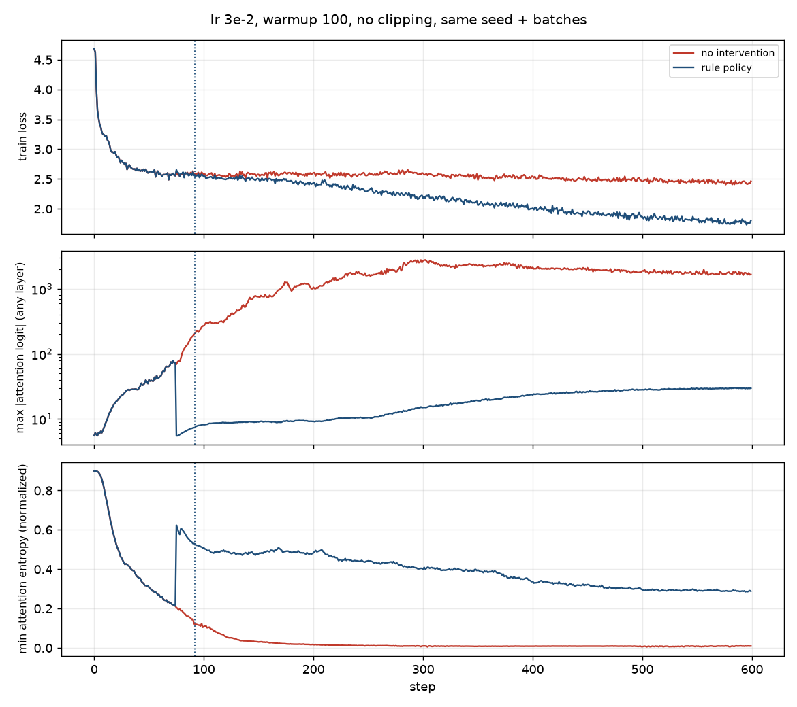
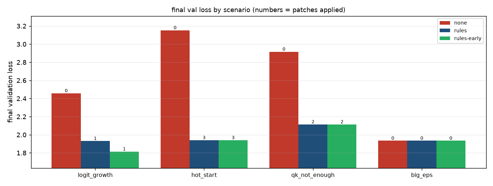
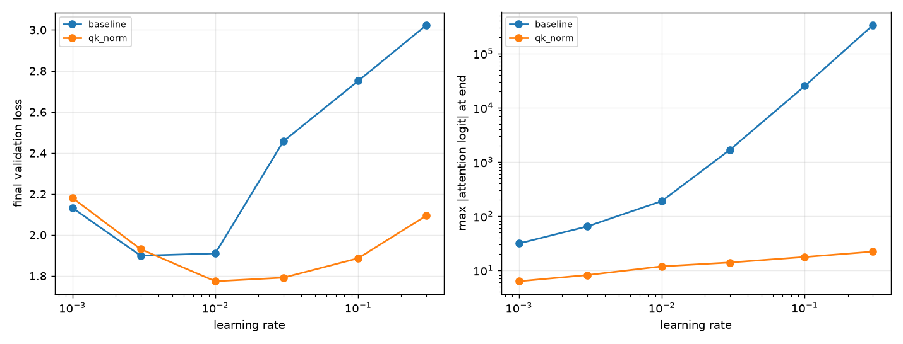

# gradwarden

an on-call agent for transformer training runs, in jax.

cheap detectors watch every step for the instabilities people actually hit when pretraining (attention logit growth, entropy collapse, log Z drift, loss/grad spikes, nans). when one trips, training pauses, an llm agent gets an incident brief, pokes at the metrics with tools, and proposes a config patch + a step to rewind to. the trainer validates the patch, rolls back to the newest checkpoint before the problem, and keeps going.

talks to a local model via ollama (built against qwen3.5 9b), gemini, or anything w/ an openai style chat completions api (llama.cpp server, vllm, lm studio).

after a patch it keeps watching to see if the fix held, escalates if the same problem comes back, can page you on a webhook, and writes a postmortem when the run ends.



## results

all on cpu. 822k param char-level transformer, tinyshakespeare, 600 steps, seed 0. raw numbers in [docs/results/](docs/results/).

**demo: same unstable config (lr 3e-2, warmup 100, no clipping), same batches**

| | final val loss | alerts | what happened |
|---|---|---|---|
| no intervention | 2.457 | 42 | attn logits climb to ~1.7k, attention goes one-hot (entropy 0.01) |
| rule policy | **1.931** | 1 | step 92: layer 1 logit hit 207 → `qk_norm=true`, rewound to step 75 (last ckpt where logits were < 100). redid 17 steps |
| llm agent (qwen3.5 9b) | not run yet | | first attempt sat in my ollama queue for the full 10 min timeout, so it fell back to the rule table (logged as `fallback_used`). rerun pending |

the figure up top is that run. red = left alone, blue = patched at the dotted line.

**bench: 4 broken configs x 3 policies** (`make bench`, 600 steps each, same seed)



| scenario | policy | final val loss | alerts (critical) | patches | steps redone | outcomes |
|---|---|---|---|---|---|---|
| logit_growth | none | 2.457 | 46 (42) | 0 | 0 | - |
| logit_growth | rules | 1.931 | 4 (1) | 1 | 18 | held |
| logit_growth | rules + `--early` | **1.815** | 1 (1) | 1 | 4 | held |
| hot_start | none | 3.153 | 55 (52) | 0 | 0 | - |
| hot_start | rules | **1.940** | 5 (5) | 3 | 9 | superseded, refired, held |
| qk_not_enough | none | 2.916 | 62 (60) | 0 | 0 | - |
| qk_not_enough | rules | **2.115** | 2 (2) | 2 | 6 | refired, held |
| big_eps | none / rules | 1.934 | 24 (0) | 0 | 0 | - |

- logit_growth: acting on the forecast at step 28 instead of the threshold at 92 means a 4 step redo instead of 18, and the model never spends 60 steps w/ half-broken attention. 1.815 vs 1.931
- hot_start (lr 3e-1, no warmup) and qk_not_enough (lr 1.0, qk_norm already on) both blow up log Z at step 2. the first version of the rule table just kept turning up z_loss (1e-4 -> 1e-3 -> 1e-2), refired every time and ended at 2.386 / 2.829. now if a fix refires the rules go after lr + warmup + clip, which is what actually works
- `--early` doesnt change the other scenarios, they break at step 2 so theres nothing to forecast
- big_eps is the false positive check: 24 adam_epsilon warns, nothing patched, which is right

raw rows in [docs/results/bench.json](docs/results/bench.json), every run also has a `POSTMORTEM.md`.

**lr sweep: baseline vs qk-norm** (`make sweep`, [wortsman et al](https://arxiv.org/abs/2309.14322) fig 1 at laptop scale)



| lr | val loss, baseline | val loss, qk-norm | max attn logit, baseline | max attn logit, qk-norm |
|---|---|---|---|---|
| 1e-3 | 2.132 | 2.181 | 31 | 6 |
| 3e-3 | **1.899** | 1.931 | 64 | 8 |
| 1e-2 | 1.910 | **1.774** | 189 | 12 |
| 3e-2 | 2.457 | 1.792 | 1,678 | 14 |
| 1e-1 | 2.751 | 1.886 | 25,057 | 18 |
| 3e-1 | 3.023 | 2.095 | 332,966 | 22 |

without qk-norm the best lr is 3e-3 and anything above 1e-2 falls apart as logits grow without bound. with qk-norm the logits stay under ~25 at every lr, the best result is better (1.774 vs 1.899), and lr 1e-2 through 1e-1 all land within 0.12 of it. so the stable lr range gets ~10x wider. same shape as the paper, just 822k params instead of billions.

## how it works

```
 train step (jit) ──> per-layer stats ──> detectors (every step, ~free)
                                              │ critical alert
                                              v
                                   pause + incident brief
                                              │
                                     llm agent w/ tools  ──(gives up)──> rule table fallback
                                              │ propose_patch(changes, rewind_to_step)
                                              v
                         validate patch ─> apply ─> rewind to ckpt ─> resume
```

**model** (`model.py`): small pre-LN decoder in flax. every forward pass also returns, per layer, the max |attention logit|, normalized attention entropy, and residual RMS. the q/k layernorm params always exist so `qk_norm` can be flipped mid-run without changing the param tree.

**trainer** (`train.py`): jitted step returns grad norm + update/param ratio per module, log Z, output logit max. keeps a ring of in-memory checkpoints. batches are a pure function of (seed, step) so a rewind replays the exact same data and the only thing that changes after a patch is the patch.

**detectors** (`detectors.py`): ema z-score on loss and grad norm (zclip style, outliers dont update the baseline), thresholds on attn logits / entropy / log Z, nan check, adam-epsilon check, val divergence. thresholds came from probe runs, see [docs/NOTES.md](docs/NOTES.md).

**forecast** (`forecast.py`): log-linear fit on each layers attn logits over the last 20 steps. if the fit is good and the line crosses 200 within 40 steps it raises `attn_logit_forecast`. warn by default, `--early` makes it critical so the policy acts before anything is actually broken. on the demo config it fires at step 28, the threshold one at 92.

**follow up** (`session.py`): after a patch the session watches the next 75 steps. same alert family fires again -> `refired`, otherwise `held`. outcomes go to `followups.jsonl`, into the next brief, and the `get_intervention_history` tool. the rule table escalates on its own (qk_norm already on -> halve lr + clip, z_loss already set -> 10x it).

**agent** (`agent/`): the brief has the alert, config, downsampled trajectories and per-layer stats at the alert step, so a decent model can answer in one call. tools if it wants more: `get_run_overview`, `get_metric_window`, `get_layer_breakdown`, `compare_steps`, `find_onset`, `get_intervention_history`, and two terminal ones, `propose_patch` and `declare_no_action`. patches are validated against an allowlist with ranges (lr, warmup, clip, z_loss, eps, b2, weight decay, qk_norm) so the model cant do anything weird. if it wont decide it falls back to a fixed rule table, and that gets logged. connection errors / 5xx get one retry, and `GRADWARDEN_LLM_DEADLINE` caps the whole diagnosis.

**checkpoints** (`ckpt.py`): `--save-ckpts` mirrors the in-memory ring to `RUN_DIR/ckpt` (flax msgpack + the config json at that step). `gradwarden resume` picks a dead run back up, drops the records the ckpt doesnt cover, and replays the rest thru the detectors so the ema baselines come back the same. resuming is exact, theres a test.

**on call bits**: `--webhook URL` (or `GRADWARDEN_WEBHOOK`) pages slack/discord on critical alerts, patches and followups. `--approve` asks y/n in the terminal before applying anything. every run ends with a `POSTMORTEM.md` next to `summary.json`.

**rule baseline** (`RulePolicy`): alert kind -> textbook fix. its there to compare the agent against.

## run it

```bash
uv sync
make test

# plain training w/ detectors on
uv run gradwarden train --run-dir runs/a --lr 3e-2 --warmup 100 --clip 0

# with the agent. OLLAMA_HOST defaults to localhost:11434
OLLAMA_HOST=http://yourbox:11434 uv run gradwarden watch --policy ollama --run-dir runs/b --lr 3e-2 --warmup 100 --clip 0

# or gemini
GEMINI_API_KEY=... uv run gradwarden watch --policy gemini --run-dir runs/c --lr 3e-2 --warmup 100 --clip 0

# ask the agent about an alert in a run thats already done
uv run gradwarden diagnose runs/a --policy ollama --transcript

# named broken configs instead of remembering flags
uv run gradwarden scenarios
uv run gradwarden watch --policy rules --scenario hot_start --early --save-ckpts --run-dir runs/d

# follow it from another shell, compare runs, writeup
uv run gradwarden tail runs/d
uv run gradwarden compare runs/a runs/d --out runs/cmp.png
uv run gradwarden postmortem runs/d

# process died? pick it back up from the newest ckpt
uv run gradwarden resume runs/d --policy rules --steps 600

make demo    # same config 3 ways: nothing / rules / agent
make sweep   # lr sweep, baseline vs qk-norm
make bench   # every scenario x none / rules / rules-early
```

env vars: `OLLAMA_HOST`, `GRADWARDEN_OLLAMA_MODEL` (default `qwen3.5:9b-text`), `GEMINI_API_KEY`, `GRADWARDEN_GEMINI_MODEL`, `GRADWARDEN_OPENAI_BASE_URL`, `GRADWARDEN_OPENAI_API_KEY`, `GRADWARDEN_OPENAI_MODEL`, `GRADWARDEN_LLM_DEADLINE`, `GRADWARDEN_WEBHOOK`.

everything runs on cpu. a 600 step run is ~1-2 min on cpu.

## layout

```
src/gradwarden/
  model.py        flax transformer that reports its own internals
  train.py        jitted step + Trainer w/ checkpoints, patch, rewind
  detectors.py    per-step detectors
  forecast.py     early warning on attn logit growth
  store.py        jsonl run store, keeps abandoned branches
  session.py      train -> detect -> diagnose -> patch -> rewind loop + follow up
  ckpt.py         disk checkpoints for resume
  scenarios.py    named broken configs
  notify.py       webhook pager
  postmortem.py   markdown writeup per run
  live.py         `tail` for a running run
  agent/llm.py    ollama + gemini + openai compat + scripted backends
  agent/tools.py  agent tools
  agent/warden.py brief, llm loop, rule baseline
  report.py       plots
  cli.py
experiments/      demo.sh, lr_sweep.py, bench.py, make_figures.py
docs/NOTES.md     probe numbers, threshold choices, backend notes
tests/            66 tests, cpu, ~35s
```

## limitations

- 822k params on tinyshakespeare. the failure modes are the same ones from the papers (wortsman et al show they show up in small models at high lr) but this is not a claim about what happens at real scale
- single device. no sharding
- the log Z / output divergence detector never fired in the original probe runs. it does fire at lr >= 3e-1 (hot_start / qk_not_enough scenarios), at step 2
- the gemini backend is only tested against mocked responses
- ollama: tool calling verified live against qwen3.5 9b (it returns proper `tool_calls`), but a full diagnosis in the demo hasnt completed yet bc of queueing on the ollama host. see results. the bench hasnt been run w/ an llm policy either, only rules
- openai compat backend is tested against mocked responses only
- disk ckpts are full copies every 25 steps, fine at 822k params, would need sharded/async saving for anything real
- if a run dies in the middle of a follow up window, that intervention never gets an outcome

## how i built this

the order went: probe first (do these instabilities even show up at 822k params on a laptop? yes, see notes), then set detector thresholds from the probe, then build the agent loop, then run the demo. every number in this readme comes from a real run — snapshots in `docs/results/`, reproduce with `make demo` / `make sweep`.

the interesting constraint was a slow llm. a 9b with queued requests does ~5 tok/s. so the detectors do all the per-step watching, the agent only wakes up on a critical alert, and it gets a brief complete enough to decide in one call. it is tested against qwen3.5 9b over the lan with partial gpu offload.


## refs

- Wortsman et al. 2023, [Small-scale proxies for large-scale Transformer training instabilities](https://arxiv.org/abs/2309.14322)
- Dehghani et al. 2023, Scaling Vision Transformers to 22 Billion Parameters (qk-layernorm)
- Zhai et al. 2023, [Stabilizing Transformer Training by Preventing Attention Entropy Collapse](https://arxiv.org/abs/2303.06296)
- Chowdhery et al. 2022, PaLM (z-loss)
- Kumar et al. 2025, [ZClip: Adaptive Spike Mitigation for LLM Pre-Training](https://arxiv.org/abs/2504.02507)
