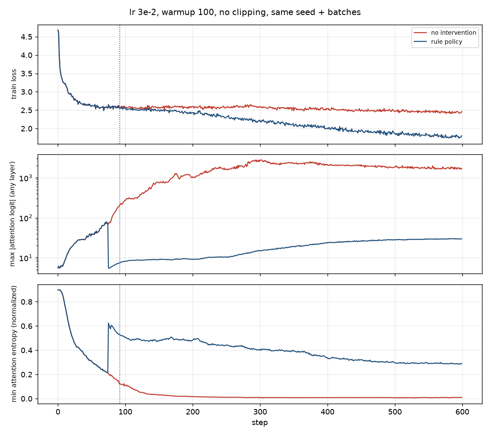
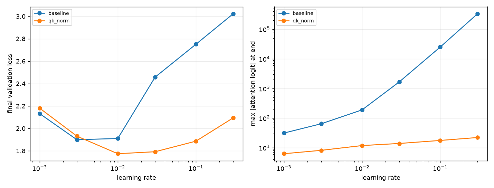

# gradwarden

an on-call agent for transformer training runs, in jax.

cheap detectors watch every step for the instabilities people actually hit when pretraining (attention logit growth, entropy collapse, log Z drift, loss/grad spikes, nans). when one trips, training pauses, an llm agent gets an incident brief, pokes at the metrics with tools, and proposes a config patch + a step to rewind to. the trainer validates the patch, rolls back to the newest checkpoint before the problem, and keeps going.

talks to a local model via ollama (built against qwen3.5 9b) or to gemini.



## results

all on cpu. 822k param char-level transformer, tinyshakespeare, 600 steps, seed 0. raw numbers in [docs/results/](docs/results/).

**demo: same unstable config (lr 3e-2, warmup 100, no clipping), same batches**

| | final val loss | alerts | what happened |
|---|---|---|---|
| no intervention | 2.457 | 42 | attn logits climb to ~1.7k, attention goes one-hot (entropy 0.01) |
| rule policy | **1.931** | 1 | step 92: layer 1 logit hit 207 → `qk_norm=true`, rewound to step 75 (last ckpt where logits were < 100). redid 17 steps |
| llm agent (qwen3.5 9b) | not run yet | | first attempt sat in my ollama queue for the full 10 min timeout, so it fell back to the rule table (logged as `fallback_used`). rerun pending |

the figure up top is that run. red = left alone, blue = patched at the dotted line.

**lr sweep: baseline vs qk-norm** (`make sweep`, [wortsman et al](https://arxiv.org/abs/2309.14322) fig 1 at laptop scale)



| lr | val loss, baseline | val loss, qk-norm | max attn logit, baseline | max attn logit, qk-norm |
|---|---|---|---|---|
| 1e-3 | 2.132 | 2.181 | 31 | 6 |
| 3e-3 | **1.899** | 1.931 | 64 | 8 |
| 1e-2 | 1.910 | **1.774** | 189 | 12 |
| 3e-2 | 2.457 | 1.792 | 1,678 | 14 |
| 1e-1 | 2.751 | 1.886 | 25,057 | 18 |
| 3e-1 | 3.023 | 2.095 | 332,966 | 22 |

without qk-norm the best lr is 3e-3 and anything above 1e-2 falls apart as logits grow without bound. with qk-norm the logits stay under ~25 at every lr, the best result is better (1.774 vs 1.899), and lr 1e-2 through 1e-1 all land within 0.12 of it. so the stable lr range gets ~10x wider. same shape as the paper, just 822k params instead of billions.

## how it works

```
 train step (jit) ──> per-layer stats ──> detectors (every step, ~free)
                                              │ critical alert
                                              v
                                   pause + incident brief
                                              │
                                     llm agent w/ tools  ──(gives up)──> rule table fallback
                                              │ propose_patch(changes, rewind_to_step)
                                              v
                         validate patch ─> apply ─> rewind to ckpt ─> resume
```

**model** (`model.py`): small pre-LN decoder in flax. every forward pass also returns, per layer, the max |attention logit|, normalized attention entropy, and residual RMS. the q/k layernorm params always exist so `qk_norm` can be flipped mid-run without changing the param tree.

**trainer** (`train.py`): jitted step returns grad norm + update/param ratio per module, log Z, output logit max. keeps a ring of in-memory checkpoints. batches are a pure function of (seed, step) so a rewind replays the exact same data and the only thing that changes after a patch is the patch.

**detectors** (`detectors.py`): ema z-score on loss and grad norm (zclip style, outliers dont update the baseline), thresholds on attn logits / entropy / log Z, nan check, adam-epsilon check. thresholds came from probe runs, see [docs/NOTES.md](docs/NOTES.md).

**agent** (`agent/`): the brief has the alert, config, downsampled trajectories and per-layer stats at the alert step, so a decent model can answer in one call. tools if it wants more: `get_run_overview`, `get_metric_window`, `get_layer_breakdown`, `compare_steps`, and two terminal ones, `propose_patch` and `declare_no_action`. patches are validated against an allowlist with ranges (lr, warmup, clip, z_loss, eps, weight decay, qk_norm) so the model cant do anything weird. if it wont decide it falls back to a fixed rule table, and that gets logged.

**rule baseline** (`RulePolicy`): alert kind -> textbook fix. its there to compare the agent against.

## run it

```bash
uv sync
make test

# plain training w/ detectors on
uv run gradwarden train --run-dir runs/a --lr 3e-2 --warmup 100 --clip 0

# with the agent. OLLAMA_HOST defaults to localhost:11434
OLLAMA_HOST=http://yourbox:11434 uv run gradwarden watch --policy ollama --run-dir runs/b --lr 3e-2 --warmup 100 --clip 0

# or gemini
GEMINI_API_KEY=... uv run gradwarden watch --policy gemini --run-dir runs/c --lr 3e-2 --warmup 100 --clip 0

# ask the agent about an alert in a run thats already done
uv run gradwarden diagnose runs/a --policy ollama --transcript

make demo    # same config 3 ways: nothing / rules / agent
make sweep   # lr sweep, baseline vs qk-norm
```

env vars: `OLLAMA_HOST`, `GRADWARDEN_OLLAMA_MODEL` (default `qwen3.5:9b-text`), `GEMINI_API_KEY`, `GRADWARDEN_GEMINI_MODEL`.

everything runs on cpu. a 600 step run is ~1-2 min on cpu.

## layout

```
src/gradwarden/
  model.py        flax transformer that reports its own internals
  train.py        jitted step + Trainer w/ checkpoints, patch, rewind
  detectors.py    per-step detectors
  store.py        jsonl run store, keeps abandoned branches
  session.py      train -> detect -> diagnose -> patch -> rewind loop
  agent/llm.py    ollama + gemini + scripted backends
  agent/tools.py  agent tools
  agent/warden.py brief, llm loop, rule baseline
  report.py       plots
  cli.py
experiments/      demo.sh, lr_sweep.py
docs/NOTES.md     probe numbers, threshold choices, backend notes
tests/            25 tests, cpu, ~10s
```

## limitations

- 822k params on tinyshakespeare. the failure modes are the same ones from the papers (wortsman et al show they show up in small models at high lr) but this is not a claim about what happens at real scale
- single device. no sharding
- the log Z / output divergence detector never fired in my runs, its implemented and tested on synthetic data only
- the gemini backend is only tested against mocked responses
- ollama: tool calling verified live against qwen3.5 9b (it returns proper `tool_calls`), but a full diagnosis in the demo hasnt completed yet bc of queueing on the ollama host. see results
- in-memory checkpoints only

## how i built this

the order went: probe first (do these instabilities even show up at 822k params on a laptop? yes, see notes), then set detector thresholds from the probe, then build the agent loop, then run the demo. every number in this readme comes from a real run — snapshots in `docs/results/`, reproduce with `make demo` / `make sweep`.

the interesting constraint was a slow llm. a 9b with queued requests does ~5 tok/s. so the detectors do all the per-step watching, the agent only wakes up on a critical alert, and it gets a brief complete enough to decide in one call. it is tested against qwen3.5 9b over the lan with partial gpu offload.


## refs

- Wortsman et al. 2023, [Small-scale proxies for large-scale Transformer training instabilities](https://arxiv.org/abs/2309.14322)
- Dehghani et al. 2023, Scaling Vision Transformers to 22 Billion Parameters (qk-layernorm)
- Zhai et al. 2023, [Stabilizing Transformer Training by Preventing Attention Entropy Collapse](https://arxiv.org/abs/2303.06296)
- Chowdhery et al. 2022, PaLM (z-loss)
- Kumar et al. 2025, [ZClip: Adaptive Spike Mitigation for LLM Pre-Training](https://arxiv.org/abs/2504.02507)
